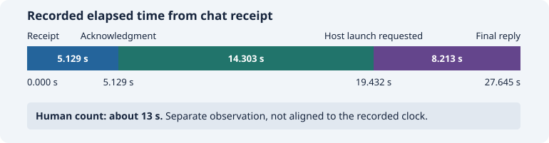

# ChatGPT Desktop, Dot, and Codex in VS Code

The surface where you send a request, the process that owns a coding thread, and the computer that runs a command are separate. See [execution environments](execution-environments.md) for cloud environment definitions, disposable task instances, and file identities.

| Surface | What it can do | Useful boundary |
| --- | --- | --- |
| ChatGPT desktop with Dot and a connected computer | Coordinate work and, with local access, run a command on the connected host. | A direct desktop command does not require a separate coding task. Interactive launch can still require permission outside the command sandbox. |
| Codex in the VS Code sidebar | Send a turn to an IDE-managed thread, observe it in the editor, and retain the turn in history. | An authorized history reader can read the result without taking over the live thread. |
| Codex App Server | Offer a JSON-RPC interface for host clients and their threads. | Two clients seeing the same persisted thread is not proof that they share its active writer. |

[Local computer access](https://help.openai.com/en/articles/20001530-getting-started-with-your-dot) and the [App Server protocol](https://learn.chatgpt.com/docs/app-server) describe the supported surfaces. Availability varies by version, account, and permissions.

## One direct launch, measured

In a November 2026 Windows spot check, a Dot request launched Calculator on the connected desktop without a worker thread. This was a repeat launch, not a cold-start benchmark. One PowerShell invocation requested the visible launch, waited 350 ms, and looked for a window titled Calculator. Finding the window confirmed presence, not that a new window was created, brought to the front, or displayed at a particular instant.

| Event | Offset from recorded chat receipt | What it measures |
| --- | ---: | --- |
| Request recorded | 0.000 s | Chat timestamp used as the recorded baseline, not a client click timestamp. |
| Acknowledgment recorded | 5.129 s | When the short acknowledgment was recorded, not when it was read. |
| Host launch request | 19.432 s | Windows timestamp taken immediately before invoking the launcher. |
| Window presence | Not independently timestamped | Confirmed inside the same invocation; the tool reported 0.801 s for that command's execution, which included the 350 ms wait. |
| Final reply recorded | 27.645 s | Chat timestamp of the result message, not notification delivery. |
| Human observation | About 13 s by count | A client-side observation with an uncalibrated start point and no synchronized timestamp. |

The 13-second count and the 19.432-second recorded interval are different measurements. We cannot order the human observation relative to the host event on one shared timeline or use the difference to estimate verification overhead. The tool call reported about 7.9 s of wall time including work outside the PowerShell process. Neither that number nor the bar identifies how much time was spent on approval, dispatch, startup, or model work.

For a repeatable check, record a monotonic interval inside the host process from immediately before launch to window detection. Use a bounded window wait and return both measurements in one call. Record the client send and first visible frame on the same client clock if perceived latency matters. Separate cold and warm trials. A successful launch request with no window check is a lower-confidence result, not a window-open measurement.

## Why an IDE thread can be readable but not writable

A Windows spot check of the installed Codex VS Code extension, version `26.1111.21308`, found that its shipped JavaScript starts the bundled `codex.exe` with the `app-server` subcommand and uses JSONL over child-process pipes. This is a bundle observation, not a compatibility guarantee or a claim that the extension source itself is public. OpenAI publishes the [CLI, App Server, and SDK](https://developers.openai.com/blog/codex-as-a-platform) as open-source components.

A direct Codex CLI resume of an already-open IDE thread returned an active-writer conflict. Sending a synthetic test prompt through the existing VS Code composer worked; the reply was visible in the sidebar and in saved history. For an actively used desktop, preparing a prompt for the operator to paste and reading the result from history avoids taking window focus. A shared-runtime integration should be tested first with synthetic data and a disposable thread. A trace of protocol method names and timing can confirm transport without collecting prompt, result, or authentication payloads.

## Deliver a workspace artifact as a saved file

In one disposable Codex workspace, the prepared Python upload helper (`library_upload.py`) returned HTTP 401 twice during its hosted app tool-discovery step, before transferring the file. The same existing artifact was saved from its producing workspace using the native single-file Library upload route and then attached in ChatGPT. That recovered delivery; it did not explain or fix helper authentication. This is not evidence that all uploads fail, that a CLI binary needs replacing, or that a Library attachment automatically publishes into a Space.

Prefer the supported native upload in the workspace that holds the bytes, when available. Verify the file's saved identity and size, then use a native attachment or the intended Space's supported file operation. A path pointing into a task workspace is not a user-facing attachment. If a route fails at discovery, report that stage accurately and try another authorized route instead of repeatedly retrying it.
