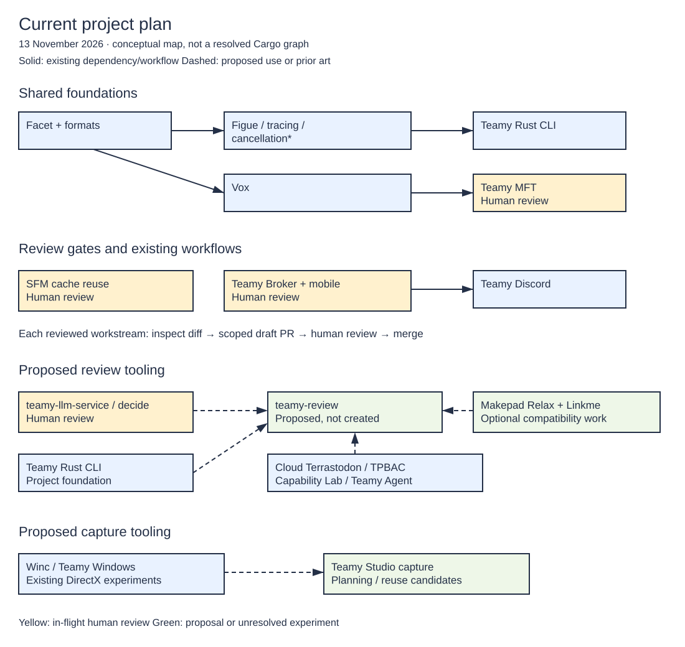

# Current project plan

**Planning snapshot: 13 November 2026.** This is a curated map of current work and intended review gates, not a live repository inventory or a statement that every dependency is release-ready. An open editor window is not evidence of activity or correctness.

## See the relationships

[Open the full-size diagram](diagrams/current-project-plan.svg).

[Download the editable Excalidraw scene](diagrams/current-project-plan.excalidraw). Open it locally in an Excalidraw-compatible editor. The SVG is embedded directly; this page does not send the scene to a hosted editor or load an interactive editor service.

The asterisk on cancellation denotes feature-dependent dependencies. Solid arrows show existing dependencies or workflows. Dashed arrows show proposed reuse, architectural prior art or an unresolved experiment. The shared-foundation grouping is conceptual: individual features determine whether a dependency is active, and the map does not imply that every consumer has adopted the same version. See the [Facet ecosystem snapshot](facet-ecosystem.md) for revision-specific evidence rather than treating this drawing as a Cargo lockfile.

## Track in-flight work through human review

Unreviewed changes should become scoped pull requests against their own repositories, with their in-flight nature visible. A candidate below is **not a claim that a pull request already exists**. No PR was created as part of this documentation update.

| Workstream | Current position | Next reviewable outcome | Evidence / review record |
| --- | --- | --- | --- |
| [SFM](https://github.com/TeamDman/SuperFactoryManager) cache reuse | In-flight; maintainer-guided remediation and human review | A scoped candidate PR with evidence for warm build time, cache footprint, reusable artifacts and clean reconstruction. Preserve deobfuscated sources for analysis. | Maintainer planning direction, 13 Nov 2026; see [migration discipline](migration-workflows.md). PR not linked yet. |
| [Teamy Broker](https://github.com/TeamDman/teamy-broker), including mobile | In-flight; human review required | Review configuration, authorization boundaries and mobile behavior in coherent changes rather than treating compilation as approval. | Maintainer planning direction, 13 Nov 2026. [Decision cooldown #1](https://github.com/TeamDman/teamy-broker/issues/1) is separately queued, not implemented by this plan. |
| [Teamy MFT](https://github.com/TeamDman/teamy-mft) | In-flight; human review required | Scoped changes with sync/query regression evidence and dependency compatibility checks. | Maintainer planning direction, 13 Nov 2026; [dependency map](facet-ecosystem.md) is an older version snapshot, not a fresh qualification. |
| [teamy-llm-service](https://github.com/TeamDman/teamy-llm-service) | In-flight changes need review | Reconcile daemon/decide work and qualify the structured request/result contract before a consumer relies on it. | Maintainer planning direction, 13 Nov 2026; [finite choices](finite-choice-models.md), [resident inference](resident-inference.md). |
| Makepad Relax / Linkme | Compatibility investigation remains unresolved | A minimal reproducible Windows registration test, with explicit supported and unsupported behavior. | [Interactive Rust investigation](interactive-rust.md); not a prerequisite for an initial stdio-based review experiment. |
| teamy-review | Proposed; not created | Specify repository snapshots, annotations, validated staging plans and apply receipts before implementation. | Planning proposal, 13 Nov 2026; [decision planning](decision-planning.md). |
| Teamy Studio capture workflow | Planning; reuse and branch direction undecided | Review the existing Studio boundary and select a 4K region-capture-to-clipboard/PNG slice with measured latency. | [Capture plan](sharex-replacement.md); [screen capture prior art](screen-capture.md). |
| New-project instructions | Local correction awaiting review and publication | Review the two instruction edits naming both teamy-rust-cli and Cloud Terrastodon and the current initializer path. | 13 Nov 2026 instruction audit; [project foundation](rust-cli-template.md). Not claimed committed or published. |

### Make a review candidate useful

1. Establish the base revision, working tree and already-staged changes. Preserve unrelated work and obtain approval before a new branch/worktree when required.
2. Review for secrets, private information and accidental generated artifacts before publishing any branch.
3. Split into coherent changes with a stated purpose, contract, tests and known gaps. Use a draft PR while the work is incomplete or awaiting human review.
4. Record the actual PR link, head/base revisions and validation evidence here. Distinguish "implemented", "tested", "reviewed" and "merged".
5. Merge only after the project's required human review. A model recommendation, successful build or plan entry does not grant approval.

This is a proposed review workflow, not an instruction to automatically publish every uncommitted change. In particular, a local working tree must not silently become public just because it appears in this map.

## Keep the proposed tools separable

The first teamy-review experiment can use ordinary Git diffs and an explicit `teamy-llm decide --daemon --output-format json` call. Model decisions annotate changes; deterministic validation controls the resulting staging plan. Preserve existing staging and bind a plan to the exact source/index state so stale decisions fail rather than applying approximately.

Cloud Terrastodon supplies relevant typed-request and registry patterns. TPBAC, Teamy Capability Lab and Teamy Agent provide policy and planning prior art. These are not automatically Cargo dependencies of a new tool. Makepad Relax/Linkme remains a separate compatibility experiment, so its unresolved behavior need not block a stdio-based prototype.

For capture, Winc, Teamy Windows and existing DirectX work are candidates to compare, not a preselected implementation. A gallery or replay buffer can follow the first measured capture slice; neither requires starting a general file-explorer replacement.

## Maintain this page and diagram

Update the snapshot date and the affected rows when evidence changes. Prefer public revision, issue and PR links; keep raw conversations, private paths, window titles and detailed local inventories out of the published book. No private transcript is required to use the plan.

The diagram currently uses a shared layout generator, `scripts/generate-project-plan.mjs`, which emits the native Excalidraw scene and SVG together. Run `node scripts/generate-project-plan.mjs` after changing that layout, then run the book build and link checks. This prevents the two shipped representations from drifting. If editing the scene by hand instead, deliberately update the generator or change the source-of-truth workflow before regenerating it.

The [Excalidraw CLI](https://github.com/excalidraw/cli) supports local Mermaid-to-scene conversion and SVG export. It is an alternative authoring path, not a required dependency of this book build. A future interactive editor embed should be a separate decision with local assets, accessibility and maintenance costs considered; static SVG plus an editable scene provides the first useful result now.
